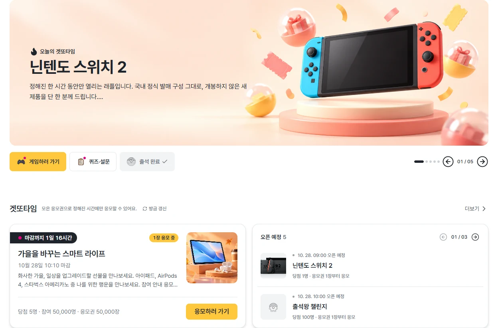
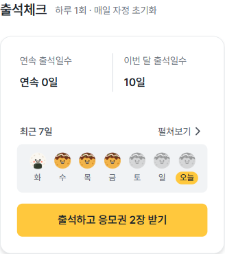
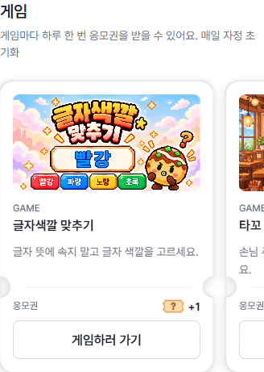
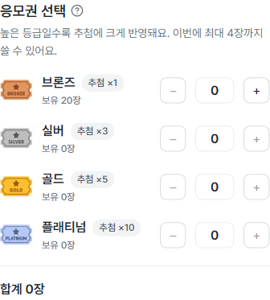
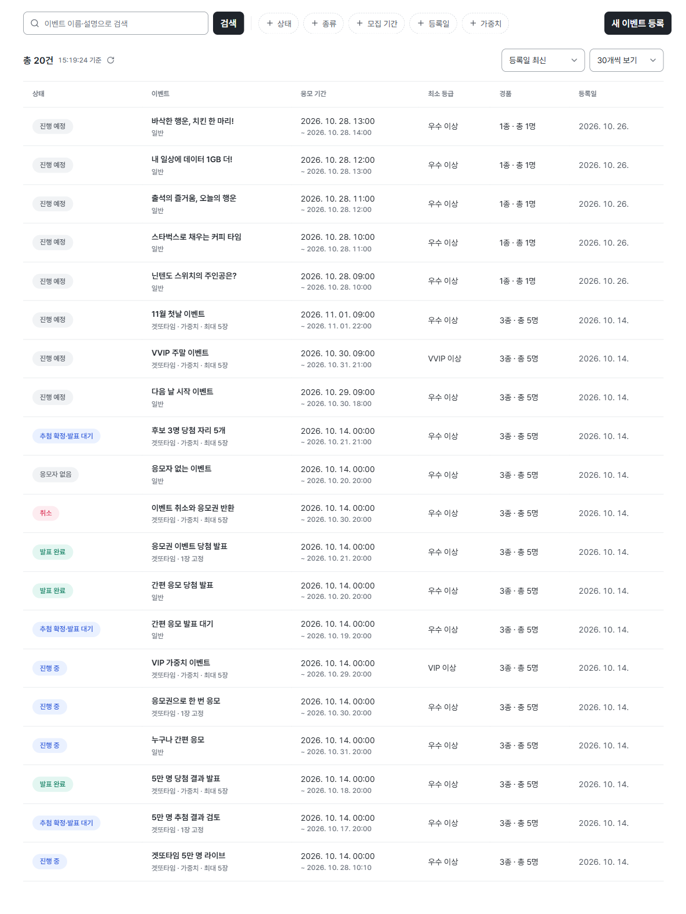

<p align="center">
  
</p>

<h1 align="center">U+ GETDDO</h1>

<p align="center">
  <strong>출석하고, 도전하고, 응모하세요.</strong><br>
  출석·미션·게임으로 모은 응모권을 이벤트 참여로 연결하는 플랫폼
</p>

<p align="center">
  <a href="https://getddo-fe.vercel.app">서비스 체험</a> ·
  <a href="#주요-기능">주요 기능</a> ·
  <a href="#핵심-설계">핵심 설계</a> ·
  <a href="#시작하기">시작하기</a> ·
  <a href="docs/README.md">문서 안내</a>
</p>

<p align="center">
  <a href="https://github.com/Uplus-GETDDO/getddo-fe/actions/workflows/ci.yml">
    
  </a>
</p>

GETDDO는 LG유플러스 멤버십 사용자를 위한 응모 이벤트 플랫폼입니다.
사용자는 출석·미션·게임으로 응모권을 모으고, 이벤트에 응모한 뒤 발표된 결과를 확인합니다.
관리자는 이벤트·응모권·추첨·결과 발표를 같은 서비스에서 운영합니다.

이 저장소는 **사용자 화면과 관리자 화면을 구현한 프론트엔드**입니다.
서비스 체험은 별도 회원가입 없이 시연용 가상 사용자를 선택해 시작합니다.

## 서비스 화면



<table>
  <tr>
    <th>출석으로 적립</th>
    <th>게임으로 적립</th>
    <th>등급별 응모권 선택</th>
  </tr>
  <tr>
    <td valign="top"></td>
    <td valign="top"></td>
    <td valign="top"></td>
  </tr>
</table>

<details>
<summary><strong>관리자 이벤트 관리 화면 보기</strong></summary>



이벤트 검색·필터·정렬·페이지 크기 선택과 이벤트 등록 진입을 제공합니다.

</details>

화면은 **2026-10-26 실제 배포본**에서 상품 이미지·게임 썸네일·출석 달력의 로딩을 확인한 뒤 다시 촬영했습니다. 계정 선택 영역을 제외한 본문 캡처이며, 데이터는 시연용입니다.
캡처 환경과 범위는 [이미지 안내](docs/assets/readme/README.md)에 기록했습니다.

## 주요 기능

| 영역        | 기능                                                                                   |
| ----------- | -------------------------------------------------------------------------------------- |
| 이벤트 참여 | 일반 이벤트와 응모권 사용 이벤트인 겟또타임 조회·응모, 멤버십 자격·응모 가능 상태 안내 |
| 응모권      | 브론즈·실버·골드·플래티넘 보유량, 적립·사용·만료 예정 이력 조회                        |
| 출석·미션   | 출석 현황과 보상, 퀴즈·설문 참여와 보상 결과 확인                                      |
| 게임 4종    | 글자색깔 맞추기·타꼬런·타꼬 타이밍·타꼬 주문의 플레이, 점수 제출·개인 통계·보상        |
| 결과·알림   | 내 응모 내역, 발표된 당첨 결과, 알림 목록·개별 읽음·전체 읽음·결과 이동                |
| 관리자 운영 | 이벤트·배너·출석 정책·미션 관리, 사용자·응모·응모권·차단 이력 조회                     |
| 추첨 운영   | 추첨 실행·후보·정합성 조회, 최초 발표, 당첨 취소·재추첨                                |
| 화면 설정   | 모바일 대응, 다크모드·큰글씨 모드                                                      |

서비스의 주요 흐름은 다음과 같습니다.

```text
출석·미션·게임 → 응모권 적립 → 이벤트 응모 → 서버 자동 추첨
→ 관리자 확인·발표 → 당첨 결과·알림 확인
```

자동 추첨은 이벤트 마감 **1분 이후** 실행 대상이 됩니다. 실제 실행은 서버 처리 상황에 따라 늦어질 수 있으며, 결과 공개는 관리자의 발표 요청을 거칩니다.

**구현과 통합 검증은 구분합니다.** 추첨 실패·재개·취소·재추첨의 격리 시나리오, 발표→알림 생성의 전체 흐름, 배너 실서버 CRUD·업로드 계약 등은 추가 확인이 남아 있습니다.
현재 근거와 제한 사항은 [연동 현황](docs/backend-integration-status.md), 측정 환경별 증거는 [검증 기록](reports/README.md)에서 확인할 수 있습니다.

## 핵심 설계

| 해결하려는 문제                      | 프론트엔드에서 적용한 방식                                                                      | 근거                                                         |
| ------------------------------------ | ----------------------------------------------------------------------------------------------- | ------------------------------------------------------------ |
| 기능 증가에 따른 화면·도메인 간 결합 | FSD 레이어와 슬라이스 공개 API를 사용하고 ESLint boundaries로 의존 방향을 검사합니다.           | [FSD 결정](docs/adr/ADR-0001-fsd-architecture.md)            |
| 서버 데이터와 UI 상태의 중복 관리    | 서버 캐시는 TanStack Query, 공유 UI 상태는 Zustand, 폼은 React Hook Form으로 책임을 구분합니다. | [상태관리 결정](docs/adr/ADR-0003-state-management-roles.md) |
| 반복 클릭·통신 오류 뒤 중복 처리     | 계약에 따라 멱등키를 사용하고, 재시도에서도 원래 요청의 키·입력을 유지합니다.                   | [멱등키 결정](docs/adr/ADR-0005-idempotency-key.md)          |
| 추첨 결과와 응모권 변동의 확인       | 서버의 추첨 후보·조건·확정 결과와 지급·사용·반환 이력을 관리자 화면에서 조회합니다.             | [추첨 연동](docs/backend-integration-status.md)              |
| 시각 차이로 인한 상태 해석 오류      | 서버 UTC를 KST로 표시합니다. 가상 시계는 로컬 개발 도구이며 서버 일정에 영향을 주지 않습니다.   | [시간 처리 결정](docs/adr/ADR-0004-utc-kst-virtual-clock.md) |
| 초기 화면 비용과 회귀                | 사용자·관리자 라우트를 지연 로딩하고, 초기 JS·CSS gzip 크기를 CI에서 검사합니다.                | [성능 버짓](docs/performance-budget.md)                      |

응모권 지급·차감과 추첨 판정은 서버가 처리합니다. 프론트엔드는 서버 응답을 Zod로 검증하고, 업무 상태·오류·재시도 경로를 화면에 표현합니다.

## 기술 스택

| 구분           | 기술과 역할                                                      |
| -------------- | ---------------------------------------------------------------- |
| 언어·UI·빌드   | TypeScript · React 19 · Vite 8                                   |
| 라우팅         | React Router 7, 사용자·관리자 라우트 분리                        |
| 서버 상태·HTTP | TanStack Query · Axios · Zod                                     |
| UI 상태·폼     | Zustand · React Context · React Hook Form                        |
| 스타일·연출    | Tailwind CSS v4 · shadcn/ui · Framer Motion · Sonner             |
| 테스트·목업    | Vitest · React Testing Library · MSW                             |
| 품질·배포      | ESLint · Prettier · Husky · commitlint · GitHub Actions · Vercel |

정확한 의존성 버전과 실행 명령은 [package.json](package.json), 품질 검사 순서는 [CI 설정](.github/workflows/ci.yml)을 따릅니다.

## 시작하기

Node.js **20.19 이상**이 필요하며, CI와 같은 **24.x**를 권장합니다. 패키지 관리자는 npm입니다.

```powershell
npm ci
Copy-Item .env.example .env.development
```

`.env.development`의 `VITE_VIRTUAL_USERS_JSON`에 [목업 계정 예시](CONTRIBUTING.md#로컬-목업-계정)를 설정한 뒤 실행합니다.

```powershell
npm run dev
```

| 환경 변수                 | 용도                                                              |
| ------------------------- | ----------------------------------------------------------------- |
| `VITE_API_BASE_URL`       | API 주소. 로컬 MSW와 Vercel 프록시 사용 시 `/api`                 |
| `VITE_ENABLE_MSW`         | `true`이면 목업 실행. Vercel 배포 설정은 `false`                  |
| `VITE_VIRTUAL_USERS_JSON` | 시연 계정 목록. 로컬 목업은 fixture ID, 실서버는 등록된 UUID 사용 |

계정 목록이 없거나 형식이 틀리면 로그인 화면에 설정 안내가 표시됩니다.
실서버 계정 설정·사용자 전환·배포 점검은 [시연 운영 안내](docs/demo-operations.md)를 참고하세요.

로컬 `npm run dev`는 [Vercel API 프록시](vercel.json)를 실행하지 않습니다. 실서버에 연결하려면 브라우저 접근과 CORS가 허용된 API 주소가 필요합니다.
가상 사용자 선택은 시연용 문맥 전환이며 실제 사용자 인증을 제공하지 않습니다.

### 검증

```powershell
npm run format:check
npm run lint
npm run test:ci
npm run build
npm run perf:budget
```

개발 환경·목업·검증·협업 절차의 상세 기준은 [기여 가이드](CONTRIBUTING.md)에서 관리합니다.

## 프로젝트 구조

```text
src/
├── app/        # 앱 부팅, 라우터, Provider, 전역 스타일
├── pages/      # 사용자·관리자 라우트 화면
├── widgets/    # 화면을 구성하는 복합 UI
├── features/   # 응모·출석·게임 등 사용자 행동
├── entities/   # 도메인 모델, API 조회, 기본 UI
├── shared/     # 공통 UI, API 클라이언트, 설정, 유틸
└── mocks/      # 로컬 개발·테스트용 MSW 목업
docs/           # 현재 기준 문서, 설계 결정, 작업 계획
reports/        # 날짜·환경별 검증 기록과 증거
scripts/        # 검증·측정 도구
```

의존 방향은 `app → pages → widgets → features → entities → shared`입니다.
상세 규칙은 [AGENTS.md](AGENTS.md)를 따릅니다.

## 팀과 저장소

**3조 얻어가유 · 총 8명**이 개발했습니다.

| 역할       | 인원 | 담당 범위                                         |
| ---------- | ---- | ------------------------------------------------- |
| 프론트엔드 | 3명  | 사용자·관리자 UI, API 연동, 화면 품질·성능 검증   |
| 백엔드     | 5명  | API, 도메인 정책 구현, 데이터 처리·추첨·서버 운영 |

| 저장소                                                     | 역할                               |
| ---------------------------------------------------------- | ---------------------------------- |
| [getddo-fe](https://github.com/Uplus-GETDDO/getddo-fe)     | 사용자·관리자 프론트엔드           |
| [getddo-be](https://github.com/Uplus-GETDDO/getddo-be)     | API와 서버 구현                    |
| [getddo-spec](https://github.com/Uplus-GETDDO/getddo-spec) | 공용 요구사항·도메인 규칙·API 계약 |

## 문서 안내

- [문서 색인](docs/README.md): 현재 기준 문서와 과거 기록의 진입점
- [설계 결정](docs/adr/README.md): 아키텍처·상태관리·목업·시간·멱등키의 판단 근거
- [디자인 시스템](docs/DESIGN-SYSTEM.md): 디자인 토큰과 사용 기준
- [연동 현황](docs/backend-integration-status.md): 구현·검증·미확인 범위
- [검증 기록](reports/README.md): 날짜와 환경을 포함한 측정 근거
